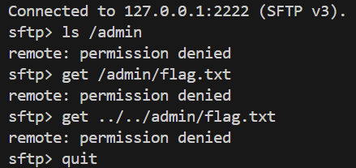
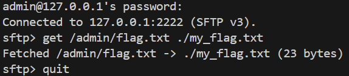

# CTF Write-Up: Securing the Admin Flag in SFTP over SSH

**Group:** Group 06  
**Course:** Computer Security — Group Project  
*Note: Generative AI was used to help format and structure this write-up.*  

---

## 1. Flag Design and Location

The flag is set at the `admin` folder (`/admin/flag.txt`), so it can only be accessed by the `admin` user and no other people can view or make any actions with it. Therefore we would call it the most secured place, where in real life we would store confidential data.

* **Flag value:** `FLAG{group06_sftp_wins}`
* **Virtual path inside SFTP:** `/admin/flag.txt`
* **Real path on the server:** `server/sftp_root/admin/flag.txt`

The goal of our CTF is to prove that unauthorized users (like `alice`, `bob`, or `eve`) cannot read, download, or tamper with this file under any circumstances, even if they attempt direct path traversal, role misuse, or symlink tricks.

---

## 2. Naive Design vs. Our Hardened Implementation

Before explaining the protections, it helps to look at how a naive SFTP server would handle this, and why naive servers get hacked so easily.

### The Naive Design (What breaks)
In a basic starter SFTP server:
1. **Direct Path Joining:** The server takes the client path string and does something like `open("sftp_root/" + path)`. An attacker simply sends `../../admin/flag.txt` and easily escapes the sandbox.
2. **Missing Search Bit Check:** The server might check read permission on `flag.txt`, but ignores whether the user has permission to traverse the parent directory `/admin`.
3. **Single Point of Failure (Only 1 security layer):** If the server relies only on file permissions, and someone accidentally runs `chmod 666` or makes a typo in configuration, the flag is immediately exposed to everyone.
4. **Silent Drops:** When an illegal path is requested, the naive server just throws a generic error or crashes, leaving zero evidence in the logs for the system administrator.

---

### Our Hardened Implementation (How we fixed it)

To protect the flag, we set up two main protection layers:

### Layer 1: Path Normalization and Jail Boundary
All requested paths are normalized and checked for dangerous characters like `:` or `..` before touching the disk.
* Paths are normalized using POSIX rules.
* We reject colons (`:`) to prevent Windows drive letter switching (`C:/...`) and NTFS Alternate Data Streams (`flag.txt::$DATA`).
* Any path trying to climb above root (`/../../../`) gets clamped to `/`.
* If a path resolves outside `sftp_root`, `safe_join()` raises an error and blocks access.

### Layer 2: Combined Policy (DAC ∧ MAC ∧ RBAC)
Inside the jail, we don't rely on just one check. We combine three independent security models into a single authorization gate:

1. **Discretionary Access Control (DAC):**
   * `/admin/flag.txt` has mode `600` (`rw-------`) and is owned by `admin:admins`.
   * The parent folder `/admin` has mode `700` (`rwx------`). Non-admin users do not have the execute/search bit (`x`) on `/admin`, so they cannot even traverse into the directory.
2. **Mandatory Access Control (MAC):**
   * The content of the folder `admin` is labeled as `confidential` (level 2).
   * Users like `alice` and `bob` are `internal` (level 1), and `eve` is `public` (level 0).
   * Under our MAC policy, we enforce **No Read Up**. A user with clearance 0 or 1 is strictly blocked from reading a level 2 confidential resource.
3. **Role-Based Access Control (RBAC):**
   * Only the role `admin` has access to the `/admin` folder.
   * Other roles (`analyst`, `visitor`) are strictly scoped to `/projects` and cannot touch `/admin`.

**Default Deny Policy:**
Based on DAC, MAC, and RBAC, we use a strict **Default Deny** policy:
$$\text{Access Allowed} = \text{DAC} \wedge \text{MAC} \wedge \text{RBAC}$$
This means that in order to get access, **all the levels should agree upon allowance**. In all other cases, access is denied. An attacker who for some reason gained access through only 1 of them still wouldn't be able to get the access.

---

## 3. Realistic Attack Attempts & How Our Checks Stop Them

### Attack 1: Directory Traversal (`../../admin/flag.txt`)
* **Scenario:** An unprivileged guest user (`eve`) knows that the secret flag is stored inside `/admin/flag.txt`. She tries to bypass folder restrictions by sending relative path traversal dots: `../../admin/flag.txt`.
* **How naive server behaves:** It resolves the dots backwards, exits `eve`'s current directory, and accesses the file.
* **How our check stops it:** 
  1. `canon_sftp_path()` normalizes the input using POSIX rules. Because it roots paths at `/`, `posixpath.normpath("/../../admin/flag.txt")` is clamped to `/admin/flag.txt`.
  2. If an attacker attempts to break out of the OS directory, `safe_join()` detects that the resolved OS path does not start with `JAIL_ROOT` and raises `PermissionError("path escape")`.
  3. `_resolve()` catches this escape attempt, logs the denied attempt to `audit.jsonl`, and returns `SSH_FX_PERMISSION_DENIED`.

### Attack 2: Analyst Trying to Read Admin Flag (Privilege Escalation)
* **Scenario:** An employee (`alice`) has legitimate login credentials and has role `analyst` with `internal` clearance. She connects via SFTP and directly requests `get /admin/flag.txt`.
* **How our check stops it:**
  * When `OPEN` is requested, the server calls `policy.authorize("alice", "read", "/admin/flag.txt")`.
  * **DAC Check:** Fails. Alice is not `admin`, and mode `600` gives zero permissions to other users. Also, directory `/admin` has mode `700`, denying her search traversal.
  * **MAC Check:** Fails. Alice has clearance `internal` (1), while `/admin/flag.txt` is `confidential` (2). Blocked by **No Read Up**.
  * **RBAC Check:** Fails. The `analyst` role only grants permissions under `/projects`.
  * Result: Access is denied immediately before any filesystem read occurs.

### Attack 3: Windows Alternate Data Stream (ADS) Bypass
* **Scenario:** On Windows hosts, attackers often try appending NTFS stream specifiers like `/admin/flag.txt::$DATA` to bypass path filters.
* **How our check stops it:**
  * In `canon_sftp_path()`, any path containing a colon (`:`) is treated as malicious and immediately rejected with `PermissionError("bad path")`.
  * The attempt is logged and blocked before touching the Windows filesystem API.

---

## 4. Evidence and Audit Logs

The server logs every single authorization decision into `server/audit.jsonl` with structured fields: `user`, `op`, `path`, `allowed`, `reason`, and a UTC `timestamp`.

### Evidence 1: Terminal Session of Blocked Attacks (Unauthorized User)
When an unauthorized user (`bob`, holding `analyst` role and `internal` clearance) attempts to list the `/admin` directory, download `/admin/flag.txt`, or perform path traversal, the client terminal clearly displays access denials:



The denied attempts are recorded in `server/audit.jsonl`:

```json
{"user":"bob","op":"list","path":"/admin","allowed":false,"reason":"DAC: other mode denies list (requires 5, has 0); MAC: no read up (clearance below resource label); RBAC: no role grants this operation on this path","timestamp":"2026-11-14T16:30:32.691588+00:00"}
{"user":"bob","op":"read","path":"/admin/flag.txt","allowed":false,"reason":"DAC: other mode denies read (requires 4, has 0); MAC: no read up (clearance below resource label); RBAC: no role grants this operation on this path","timestamp":"2026-11-14T16:30:45.781965+00:00"}
```
*Notice how each check independently blocks the request: DAC blocks the missing permissions, MAC enforces No Read Up, and RBAC sees no matching role.*

### Evidence 2: Legitimate Administrator Access (Authorized User)
In contrast, when the authenticated `admin` user connects, all three security models agree and allow the operation:



And `server/audit.jsonl` logs the authorized retrieval:

```json
{"user":"admin","op":"read","path":"/admin/flag.txt","allowed":true,"reason":"DAC: owner mode on /admin/flag.txt allows read; MAC: clearance permits operation; RBAC: granted by role(s) base, admin","timestamp":"2026-11-14T16:32:16.565472+00:00"}
```

---

## 5. Summary

By combining the jail with a default-deny check (DAC ∧ MAC ∧ RBAC), the flag is protected by multiple layers:
* Even if an attacker knows the path, path normalization prevents traversal tricks.
* Even if one layer were accidentally misconfigured, the other two layers still block access.
* Every attack attempt is immediately written to `audit.jsonl`, making it easy to track and review all denied attempts in the logs.

