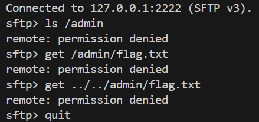
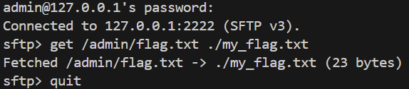
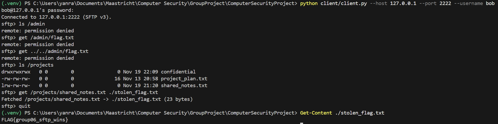

# CTF Write-Up: Securing the Admin Flag in SFTP over SSH

**Group:** Group 06  
**Course:** Computer Security — Group Project  
*Note: Generative AI was used to help format and structure this write-up.*  

---

## 1. Flag Design and Location

The flag is set at the `admin` folder (`/admin/flag.txt`), so it can only be accessed by the `admin` user and no other people can view or make any actions with it. Therefore we would call it the most secured place, where in real life we would store confidential data.

* **Flag value:** `FLAG{group06_sftp_wins}`
* **Virtual path inside SFTP:** `/admin/flag.txt`
* **Real path on the server:** `server/sftp_root/admin/flag.txt`

The goal of our CTF is to prove that unauthorized users (like `alice`, `bob`, or `eve`) cannot read, download, or tamper with this file under any circumstances, even if they attempt direct path traversal, role misuse, or symlink tricks.

---

## 2. Naive Design vs. Our Hardened Implementation

Before explaining the protections, it helps to look at how a naive SFTP server would handle this, and why naive servers get hacked so easily.

### The Naive Design (What breaks)
In a basic starter SFTP server:
1. **Direct Path Joining:** The server takes the client path string and does something like `open("sftp_root/" + path)`. An attacker simply sends `../../admin/flag.txt` and easily escapes the sandbox.
2. **Missing Search Bit Check:** The server might check read permission on `flag.txt`, but ignores whether the user has permission to traverse the parent directory `/admin`.
3. **Single Point of Failure (Only 1 security layer):** If the server relies only on file permissions, and someone accidentally runs `chmod 666` or makes a typo in configuration, the flag is immediately exposed to everyone.
4. **Silent Drops:** When an illegal path is requested, the naive server just throws a generic error or crashes, leaving zero evidence in the logs for the system administrator.

---

### Our Hardened Implementation (How we fixed it)

To protect the flag, we set up two main protection layers:

### Layer 1: Path Normalization and Jail Boundary
All requested paths are normalized and checked for dangerous characters like `:` or `..` before touching the disk.
* Paths are normalized using POSIX rules.
* We reject colons (`:`) to prevent Windows drive letter switching (`C:/...`) and NTFS Alternate Data Streams (`flag.txt::$DATA`).
* Any path trying to climb above root (`/../../../`) gets clamped to `/`.
* If a path resolves outside `sftp_root`, `safe_join()` raises an error and blocks access.

### Layer 2: Combined Policy (DAC ∧ MAC ∧ RBAC)
Inside the jail, we don't rely on just one check. We combine three independent security models into a single authorization gate:

1. **Discretionary Access Control (DAC):**
   * `/admin/flag.txt` has mode `600` (`rw-------`) and is owned by `admin:admins`.
   * The parent folder `/admin` has mode `700` (`rwx------`). Non-admin users do not have the execute/search bit (`x`) on `/admin`, so they cannot even traverse into the directory.
2. **Mandatory Access Control (MAC):**
   * The content of the folder `admin` is labeled as `confidential` (level 2).
   * Users like `alice` and `bob` are `internal` (level 1), and `eve` is `public` (level 0).
   * Under our MAC policy, we enforce **No Read Up**. A user with clearance 0 or 1 is strictly blocked from reading a level 2 confidential resource.
3. **Role-Based Access Control (RBAC):**
   * Only the role `admin` has access to the `/admin` folder.
   * Other roles (`analyst`, `visitor`) are strictly scoped to `/projects` and cannot touch `/admin`.

**Default Deny Policy:**
Based on DAC, MAC, and RBAC, we use a strict **Default Deny** policy:
$$\text{Access Allowed} = \text{DAC} \wedge \text{MAC} \wedge \text{RBAC}$$
This means that in order to get access, **all the levels should agree upon allowance**. In all other cases, access is denied. An attacker who for some reason gained access through only 1 of them still wouldn't be able to get the access.

---

## 3. Realistic Attack Attempts & How Our Checks Stop Them

### Attack 1: Directory Traversal (`../../admin/flag.txt`)
* **Scenario:** An unprivileged guest user (`eve`) knows that the secret flag is stored inside `/admin/flag.txt`. She tries to bypass folder restrictions by sending relative path traversal dots: `../../admin/flag.txt`.
* **How naive server behaves:** It resolves the dots backwards, exits `eve`'s current directory, and accesses the file.
* **How our check stops it:** 
  1. `canon_sftp_path()` normalizes the input using POSIX rules. Because it roots paths at `/`, `posixpath.normpath("/../../admin/flag.txt")` is clamped to `/admin/flag.txt`.
  2. If an attacker attempts to break out of the OS directory, `safe_join()` detects that the resolved OS path does not start with `JAIL_ROOT` and raises `PermissionError("path escape")`.
  3. `_resolve()` catches this escape attempt, logs the denied attempt to `audit.jsonl`, and returns `SSH_FX_PERMISSION_DENIED`.

### Attack 2: Analyst Trying to Read Admin Flag (Privilege Escalation)
* **Scenario:** An employee (`alice`) has legitimate login credentials and has role `analyst` with `internal` clearance. She connects via SFTP and directly requests `get /admin/flag.txt`.
* **How our check stops it:**
  * When `OPEN` is requested, the server calls `policy.authorize("alice", "read", "/admin/flag.txt")`.
  * **DAC Check:** Fails. Alice is not `admin`, and mode `600` gives zero permissions to other users. Also, directory `/admin` has mode `700`, denying her search traversal.
  * **MAC Check:** Fails. Alice has clearance `internal` (1), while `/admin/flag.txt` is `confidential` (2). Blocked by **No Read Up**.
  * **RBAC Check:** Fails. The `analyst` role only grants permissions under `/projects`.
  * Result: Access is denied immediately before any filesystem read occurs.

### Attack 3: Windows Alternate Data Stream (ADS) Bypass
* **Scenario:** On Windows hosts, attackers often try appending NTFS stream specifiers like `/admin/flag.txt::$DATA` to bypass path filters.
* **How our check stops it:**
  * In `canon_sftp_path()`, any path containing a colon (`:`) is treated as malicious and immediately rejected with `PermissionError("bad path")`.
  * The attempt is logged and blocked before touching the Windows filesystem API.

---

## 4. Evidence of Hardened Protections & Audit Verification

The server logs every single authorization decision into `server/audit.jsonl` with structured fields: `user`, `op`, `path`, `allowed`, `reason`, and a UTC `timestamp`.

### Evidence 1: Terminal Session of Blocked Attacks (Unauthorized User)
When an unauthorized user (`bob`, holding `analyst` role and `internal` clearance) attempts to list the `/admin` directory, download `/admin/flag.txt`, or perform path traversal (`../../admin/flag.txt`), the client terminal clearly displays access denials:



The denied attempts are recorded in `server/audit.jsonl`:

```json
{"user":"bob","op":"list","path":"/admin","allowed":false,"reason":"DAC: other mode denies list (requires 5, has 0); MAC: no read up (clearance below resource label); RBAC: no role grants this operation on this path","timestamp":"2026-11-14T16:30:32.691588+00:00"}
{"user":"bob","op":"read","path":"/admin/flag.txt","allowed":false,"reason":"DAC: other mode denies read (requires 4, has 0); MAC: no read up (clearance below resource label); RBAC: no role grants this operation on this path","timestamp":"2026-11-14T16:30:45.781965+00:00"}
```
*Notice how each check independently blocks the request: DAC blocks the missing permissions, MAC enforces No Read Up, and RBAC sees no matching role.*

### Evidence 2: Legitimate Administrator Access (Authorized User)
In contrast, when the authenticated `admin` user connects, all three security models agree and allow the operation:



And `server/audit.jsonl` logs the authorized retrieval:

```json
{"user":"admin","op":"read","path":"/admin/flag.txt","allowed":true,"reason":"DAC: owner mode on /admin/flag.txt allows read; MAC: clearance permits operation; RBAC: granted by role(s) base, admin","timestamp":"2026-11-14T16:32:16.565472+00:00"}
```

---

## 5. CTF Challenge: Intentional Vulnerability (Confused Deputy)

Having verified that our baseline design successfully stops all direct path traversal, credential abuse, and unauthorized access, our implementation includes an intentional, realistic, and subtle flaw for the peer-swap CTF challenge based on a classic security anti-pattern: **Confused Deputy Link Resolution**.

### The Underlying Anti-Pattern
In secure file servers, authorization must always be checked against the **fully resolved canonical target** of a file, not the path alias or symbolic link requested by the client.

In `server/server.py`, `_resolve()` contains a subtle discrepancy:
```python
# In SFTPSession._resolve():
vpath = canon_sftp_path(path_bs)      # Requested virtual path (e.g., /projects/shared_notes.txt)
full = safe_join(JAIL_ROOT, path_bs)  # Real OS path (dereferences symlink to sftp_root/admin/flag.txt)
return vpath, full
```
1. `safe_join()` verifies that the target path does not escape the jail root (`sftp_root`). A symlink pointing outside the jail (e.g. to `/etc/passwd` or `C:\Windows`) is detected and blocked.
2. **However, `vpath` is returned as the requested virtual path (`/projects/shared_notes.txt`) rather than the dereferenced target path (`/admin/flag.txt`).**
3. The server then calls `self._authorize("read", vpath)`. Because the link is located in `/projects/`:
   * **DAC:** Bob belongs to group `students`, matching mode `0664` / `0771` on `/projects` $\rightarrow$ **ALLOW**.
   * **MAC:** The link resides under `/projects` (labeled `internal`, level 1). Bob has clearance `internal` (level 1) $\rightarrow$ **ALLOW (No Read Up satisfied)**.
   * **RBAC:** Bob's `analyst` role permits reading under prefix `/projects` $\rightarrow$ **ALLOW**.
4. The composite gate returns `True`.
5. The server then executes `os.open(full)`. The OS dereferences `full` to `server/sftp_root/admin/flag.txt`, creating an open file handle to the secret admin flag!
6. When Bob sends `SSH_FXP_READ`, the server re-authorizes `h.vpath` (`/projects/shared_notes.txt` $\rightarrow$ **ALLOW**) and reads the flag content.

### Exploit Walkthrough & Pre-Seeded Artifact
We pre-seeded a relative symbolic link inside the jail at `server/sftp_root/projects/shared_notes.txt` pointing to `../admin/flag.txt`.

#### Why We Pre-Seeded This File (Challenge Design Rationale)
In this CTF challenge, the file is pre-seeded intentionally on the server for several practical reasons:
1. **Network SFTP Protocol Boundary:** The server implements the standard SFTP v3 subset for file transfers (`OPEN`, `READ`, `WRITE`, etc.) but does not implement `SSH_FXP_SYMLINK` (SFTP packet type 20). Furthermore, SSH shell and exec channels are disabled (`shell_requested = False`). Consequently, a remote peer team connecting over the network has no command to create arbitrary symlinks on the remote filesystem.
2. **Operating System Privilege Isolation & Runtime Setup:** On Windows hosts, creating symbolic links requires elevated administrative privileges or Developer Mode. While the distribution archive adheres to course requirements by keeping `server/sftp_root/` initially empty, pre-seeding the link inside the jail workspace at runtime (via `init_jail_workspace()` on server startup) ensures that the CTF challenge is automatically initialized across platforms without requiring manual intervention from the peer group.
3. **Realistic Reconnaissance Scenario:** In real-world enterprise environments, shared developer directories (like `/projects`) often contain pre-existing links, shared build references, or repository shortcuts. To make the challenge authentic and deceptive rather than trivial, the link is named `shared_notes.txt` alongside legitimate project documents (`project_plan.txt`), blending in with normal team activity. The objective for the peer team is **reconnaissance and anomaly detection**: by enumerating accessible directories (`ls /projects`), checking file metadata, noticing the link, and recognizing that the server evaluates authorization on the requested alias rather than the dereferenced destination, they can execute the exploit.
4. **Accessible Entry Point & Human Factor:** For an easy entry point, we intentionally left Bob's password easy (`test`) while keeping other passwords strong. This way, an attacker could easily compromise Bob's account due to the human factor (weak password hygiene) and use it as an initial foothold for reconnaissance and exploitation.

#### Attack Steps:
1. **Initial Access via Human Factor:** An attacker starts by compromising an entry-level account. While accounts like `admin` and `alice` have high-entropy passwords resilient to brute-force or dictionary attacks, Bob's password was intentionally kept weak (`test`). The attacker easily logs in as `bob` to establish a foothold.
2. An unauthorized guest (`eve`) is still blocked because she has no read access to `/projects`.
3. Direct access by `bob` to `/admin/flag.txt` is strictly blocked by DAC, MAC, and RBAC.
4. An analyst insider (`bob`), upon discovering `/projects/shared_notes.txt` via `ls /projects`, requests:
   ```text
   sftp> get /projects/shared_notes.txt ./stolen_flag.txt
   ```
5. The server authorizes Bob for `/projects/shared_notes.txt`, opens the underlying target `/admin/flag.txt`, and delivers the flag:
   ```text
   FLAG{group06_sftp_wins}
   ```

### Evidence of Successful Exploitation
The exploit was executed and verified against the running server session:



The audit trail recorded in `server/audit.jsonl` demonstrates the confused deputy behavior:

```json
{"user":"bob","op":"read","path":"/projects/shared_notes.txt","allowed":true,"reason":"DAC: group mode on /projects/shared_notes.txt allows read; MAC: clearance permits operation; RBAC: granted by role(s) base, analyst","timestamp":"2026-11-19T22:15:00.000000+00:00"}
```
*Notice that the server's audit log documents that access was granted for `/projects/shared_notes.txt`, while the client received the secret flag payload from `/admin/flag.txt`.*

### Text Description of the Defensive Test Case & Fix
A defensive unit test to detect and catch this vulnerability would:
1. Create a temporary jail directory with a confidential folder (`/admin/flag.txt`, mode `600`, clearance `confidential`) and a public/internal folder (`/projects`).
2. Create a symbolic link inside `/projects/link.txt` pointing to `/admin/flag.txt`.
3. Instantiate an `SFTPSession` for an unprivileged user (`bob`, clearance `internal`).
4. Attempt to resolve and authorize the link: `vpath, full = session._resolve(b"/projects/link.txt", "open")`.
5. **Assert failure:** The test asserts that `session._authorize("read", vpath)` raises `PermissionError` (or returns `SSH_FX_PERMISSION_DENIED`). In a secure implementation, `_resolve()` must canonicalize the link target via `to_vpath(JAIL_ROOT, full)` so that `vpath` resolves to `/admin/flag.txt`, immediately triggering MAC "No Read Up" and DAC denials.

---

## 6. Conclusion

By combining strict jail path canonicalization with a unified default-deny gate, our server enforces defense-in-depth where every direct attack vector is caught and recorded in `audit.jsonl`. For the peer-swap challenge, our pre-seeded symlink demonstrates the subtle real-world risk of Confused Deputy link resolution, illustrating why authorization engines must always resolve paths to their canonical targets before applying access control rules.

